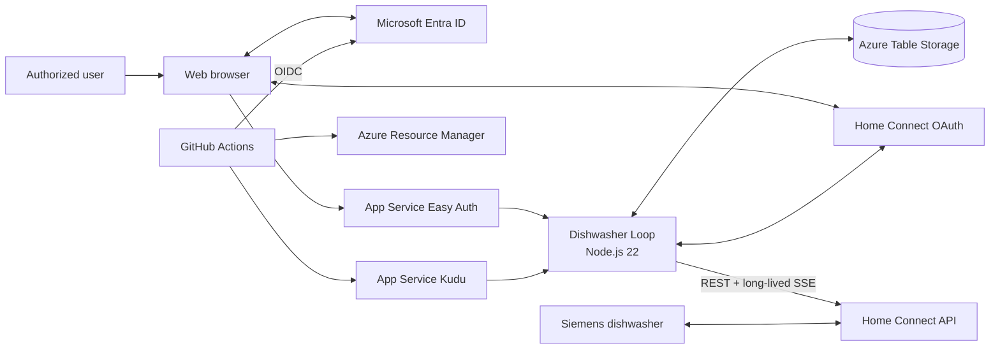
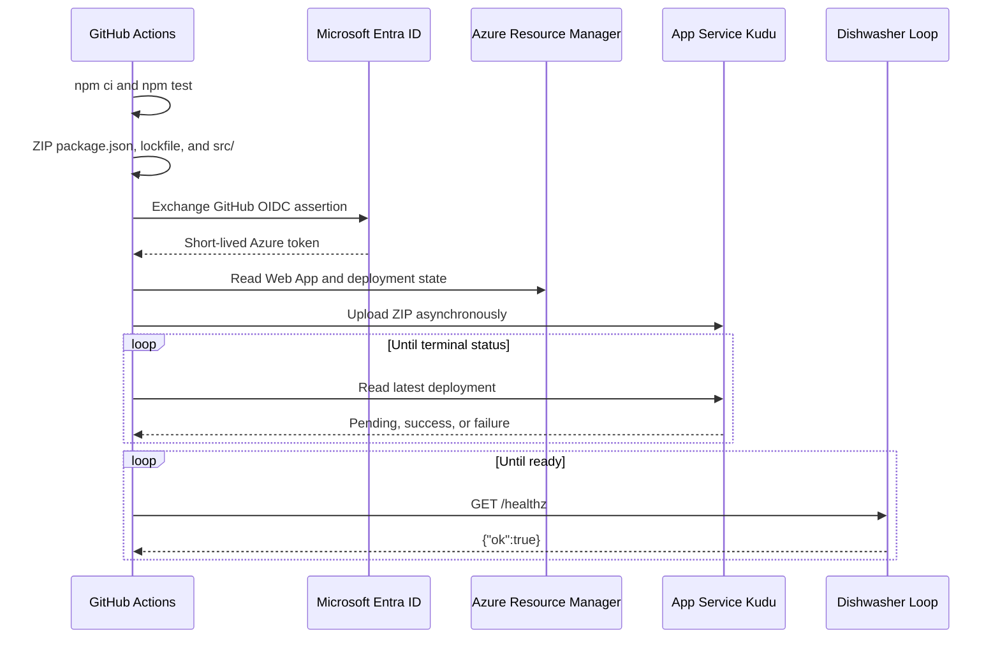

# Dishwasher Loop: End-to-End Design

## 1. Purpose and scope

Dishwasher Loop is a deliberately small, explicitly allowlisted service that
receives dishwasher changes from the Home Connect cloud, stores them, and
presents them in a minimal web UI.

The design optimizes for:

- one Home Connect account;
- one Azure App Service worker;
- low operational complexity;
- durable event and OAuth-token storage;
- no inbound appliance webhook or public event receiver;
- Microsoft authentication for all appliance data; and
- automated, secretless deployment from GitHub.

Home Connect's public API does not guarantee parity with every notification
shown by the proprietary mobile application. It exposes appliance state,
events, and notifications that are available to the registered API client.

## 2. System context



There are two independent identity boundaries:

1. **Microsoft Entra ID** authenticates the human who opens the Azure-hosted UI.
2. **Home Connect OAuth** authorizes the service to read dishwasher information
   and receive appliance events.

Signing in with Microsoft does not authorize Home Connect, and connecting Home
Connect does not grant access to the UI.

## 3. Runtime components

### 3.1 Browser single-page application

The Node service serves a static HTML shell, stylesheet, and native JavaScript
ES modules from `public/`. The browser requests current state from the
authenticated `GET /api/dashboard` endpoint and renders each dashboard tile
through a focused client component. It refreshes data in place every 30 seconds
without navigating or reloading the document.

The dashboard API reads the optional capsule count from the shared persistence
layer. Azure stores it in the `settings` / `supplies` Table Storage entity, while
local development reads `capsuleCount` from `.data/dishwasher-loop.json`. The
value must be a whole number from 0 through 999. Missing or invalid values are
shown as unavailable. This version intentionally provides no UI or API for
writing the value. OAuth login, callback, and disconnect remain full browser
navigations because they cross an authentication boundary.

The UI includes:

- appliance name, brand, type, and model;
- online/offline state;
- current Home Connect status values;
- active program, progress, adjusted remaining time, and estimated finish;
- salt and rinse-aid refill warnings;
- read-only washing-capsule inventory from shared storage;
- recommendations derived from connectivity, operation state, warnings, and
  capsule inventory;
- observed washing-cycle history plus weekly and monthly statistics;
- the latest received event type and timestamp; and
- raw payloads for persisted event history.

Home Connect exposes threshold warnings for salt and rinse aid, not exact
amounts or percentages. Until the corresponding event is observed, the UI shows
the state as unknown.

### 3.2 Node.js service

The service is an Express application running on Node.js 22. It owns:

- the Home Connect authorization-code callback;
- Home Connect access-token refresh;
- appliance discovery;
- the long-lived event streams;
- SSE parsing and client-side filtering;
- event persistence;
- resilient washing-cycle derivation and backfill;
- current diagnostics held in memory;
- authenticated dashboard, cycle-history, and cycle-statistics JSON APIs;
- static SPA asset delivery; and
- a data-free `/healthz` readiness endpoint.

The service starts monitoring automatically when persisted Home Connect tokens
exist. Disconnecting stops monitoring and deletes the OAuth tokens, but retains
event history.

### 3.3 Home Connect

Home Connect is the external control plane and event source for the dishwasher.
It provides:

- user consent and OAuth tokens;
- the paired-appliance list;
- current appliance status;
- one SSE endpoint per appliance; and
- access-token refresh.

The service requests these scopes:

- `IdentifyAppliance`
- `Dishwasher-Monitor`

The relevant endpoints are:

| Purpose | Endpoint |
|---|---|
| User authorization | `/security/oauth/authorize` |
| Code exchange and token refresh | `/security/oauth/token` |
| Appliance discovery | `/api/homeappliances` |
| Current status | `/api/homeappliances/{haId}/status` |
| Event stream | `/api/homeappliances/{haId}/events` |

See the [Home Connect authorization documentation](https://api-docs.home-connect.com/authorization/)
and [Home Connect API documentation](https://api-docs.home-connect.com/).

### 3.4 Persistence

Azure deployments use one Azure Table Storage table named `DishwasherLoop`.
Local development uses `.data/dishwasher-loop.json` through the same storage
interface.

Azure Table Storage uses three partitions:

| Partition key | Row key | Contents |
|---|---|---|
| `settings` | `oauth` | Home Connect access token, refresh token, and expiry |
| `settings` | `supplies` | Optional read-only washing-capsule count |
| `events` | timestamp plus UUID | Appliance identity, event metadata, receipt time, and JSON payload |
| `cycles` | deterministic cycle ID | Program, observed boundaries, result, confidence, evidence, gaps, and derived duration |

Tokens, events, and cycles survive App Service restarts. Azure Storage encrypts the
storage account at rest. The application reaches the account through a storage
connection string in App Service settings.

The UI reads the latest 200 events. Diagnostics replay these events oldest to
newest during monitor initialization so warning state, including salt and rinse
aid, can be restored after a process restart.

Cycle history replays all persisted events chronologically during startup
through the same state machine used for live events. Deterministic cycle IDs and
upserts make this backfill idempotent. Persisted Azure events use their Table
Storage row keys as source identities because Home Connect reuses the appliance
ID in the SSE `id` field. Existing source events are never changed.

Cycle timestamps distinguish exact observed boundaries from partial knowledge:

- `startedAt` and `finishedAt` remain null when the corresponding boundary was
  not observed reliably;
- `firstObservedAt` and `lastObservedAt` describe the observation window but are
  not substituted as exact boundaries;
- duration is calculated only when both trusted boundaries exist;
- confidence/evidence fields explain why each boundary was accepted; and
- disconnect intervals are retained as observation gaps.

## 4. Authentication and authorization

### 4.1 Microsoft user authentication

Azure App Service Authentication, also called Easy Auth, is the first request
boundary.

1. An unauthenticated browser requests the application.
2. Easy Auth redirects the browser to the tenant-specific Microsoft Entra
   authorization endpoint.
3. Entra signs in the user and returns to:

   ```text
   https://<app-name>.azurewebsites.net/.auth/login/aad/callback
   ```

4. Easy Auth validates the response, creates its session, and injects trusted
   identity headers into requests forwarded to Node.
5. Node extracts the immutable Entra principal/object ID.
6. Node allows the request only when that ID appears in the comma-separated
   `APP_ALLOWED_PRINCIPAL_IDS` setting.

The Node check is defense in depth. A different Microsoft user who successfully
authenticates still receives HTTP 403.

#### Managing authorized users

The allowlist is a comma-separated App Service setting generated from the
`allowedPrincipalIds` Bicep array. To add a user:

1. Ensure the account exists as a member or guest in the application tenant.
   Invite an external account through **Entra ID → Users → New user → Invite
   external user** and have the recipient accept the invitation.
2. Copy the user's tenant-local **Object ID** from Entra. Do not use an email
   address or an object ID from another tenant.
3. Append the Object ID to the Bicep deployment's `allowedPrincipalIds` array,
   preserving all existing IDs.
4. Apply the Bicep deployment to update `APP_ALLOWED_PRINCIPAL_IDS`.

The Node application accepts any exact Object ID in the list. Removing an ID
and reapplying Bicep revokes that user's access. The legacy singular
`APP_ALLOWED_PRINCIPAL_ID` setting remains readable during migration but is no
longer emitted by the template.

The Entra app registration must:

- be tenant-specific;
- have the App Service callback registered as a Web redirect URI;
- enable ID-token issuance because Easy Auth requests
  `response_type=code id_token`; and
- have a valid client secret referenced by
  `MICROSOFT_PROVIDER_AUTHENTICATION_SECRET`.

`/healthz` is excluded from Easy Auth and from the Node allowlist. It returns
only `{"ok":true}` and is used by App Service warm-up and deployment checks.

### 4.2 Local MCP delegated access

The local stdio MCP server reads live state from exactly one configured target:

- `local` calls the separately running local Node service over HTTP; or
- `azure` calls the deployed dashboard API over HTTPS with a delegated Entra
  bearer token.

The target is mandatory. Missing, unsupported, or mixed local/Azure
configuration stops MCP startup with an actionable error. The MCP never
automatically retries against the other target.

Azure mode uses a separate tenant-specific public-client app registration.
The existing Easy Auth registration remains the API registration and exposes a
least-privilege `Dishwasher.Read` delegated scope. The public client has that
delegated permission and uses the Mobile and desktop `http://localhost`
redirect. It has no client secret.

The MCP server connects its stdio transport before it requests authentication.
The first live-data tool call uses browser-based authorization code flow with
PKCE. This makes sign-in visible in the user's normal browser without putting a
device code in process logs or delaying the MCP initialize handshake.
Documentation tools remain available without authentication.

The access token has:

- the configured Entra tenant as issuer;
- the Easy Auth API Application ID URI as audience; and
- the exposed `Dishwasher.Read` delegated scope.

App Service Easy Auth validates the token against its configured
`allowedAudiences`, then injects the same trusted identity headers used for
browser sessions. The Node middleware applies the existing tenant-local object
ID allowlist, so possession of a valid token is not sufficient for access.

Tokens live only in the local MCP process and are not persisted. Restarting the
MCP server signs the user out and requires browser authentication on the next
live-data request. Bearer tokens, Easy Auth headers, cookies, Home Connect
tokens, storage settings, and server internals are not included in MCP output.
Only the existing sanitized overview and event projections are returned, with
`source: "local"` or `source: "azure"` metadata.

In Azure mode, the local process does not instantiate the web service,
`HomeConnectClient`, `DishwasherMonitor`, or storage. The deployed service
remains the only Home Connect monitoring channel. Local dishwasher manuals are
read directly from the configured documentation directory in both modes.

### 4.3 Home Connect authorization

Home Connect uses a separate OAuth 2.0 Authorization Code flow.

1. The authorized user selects **Connect Home Connect**.
2. Node creates a cryptographically random `state` value.
3. Node stores the state plus an HMAC signature in a ten-minute, HTTP-only,
   same-site cookie.
4. The browser is redirected to Home Connect with the client ID, exact redirect
   URI, requested scopes, and state.
5. The user signs in through Home Connect/SingleKey ID and grants consent.
6. Home Connect redirects to:

   ```text
   https://<app-name>.azurewebsites.net/auth/callback
   ```

7. Node verifies the returned state with a timing-safe comparison.
8. Node exchanges the authorization code using the Home Connect client secret.
9. Access token, refresh token, and expiry are persisted.
10. The monitor starts.

Access tokens are refreshed one minute before expiry. Concurrent callers share
one in-flight refresh operation. A Home Connect API response of HTTP 401 forces
one token refresh and one retry.

The Home Connect callback must match the developer-portal registration exactly,
including scheme, host, path, and trailing-slash behavior.

## 5. Event notification design

### 5.1 Why SSE

Home Connect does not call an application webhook. Instead, the service opens an
outbound HTTP request to each dishwasher's event endpoint and keeps the response
open. Home Connect writes events to that response as changes occur.

This is a push stream from the perspective of the running service:

```text
Dishwasher -> Home Connect cloud -> open SSE response -> Dishwasher Loop
```

The service does not periodically poll Home Connect for changes. It makes
ordinary REST calls only for discovery, initial/current status, and OAuth token
operations.

### 5.2 SSE wire protocol

The event response uses `text/event-stream`. A logical message consists of UTF-8
lines terminated by a blank line. The parser recognizes:

```text
event: NOTIFY
id: appliance-event-id
data: {"items":[{"key":"BSH.Common.Option.ProgramProgress","value":50}]}

```

Supported SSE fields are:

- `event` - Home Connect event class, defaulting to `message`;
- `id` - optional event identifier; and
- `data` - one or more lines joined with a newline.

Lines beginning with `:` are SSE comments and are ignored. Home Connect uses
keep-alive traffic to keep intermediaries and the connection active. A block
without `data` is not delivered to the event handler. JSON data is parsed into
an object; non-JSON data is retained as text.

The parser handles arbitrary network chunk boundaries. It buffers decoded text
until a complete blank-line-delimited SSE block is available.

### 5.3 Event processing

For each paired dishwasher:

1. The service gets current status through REST.
2. It opens `/events` with `Accept: text/event-stream`.
3. Each parsed event updates in-memory diagnostics.
4. Consumable event keys update derived salt/rinse-aid state.
5. The complete message is processed atomically by the per-appliance cycle
   state machine.
6. The client-side filter decides whether to persist the raw message.
7. Persisted messages become available in the event-history UI.

Home Connect does not support server-side subscriptions to selected event types
or item keys. The complete stream is always received. Persistence defaults to:

```text
STATUS, EVENT, NOTIFY
```

`KEEP-ALIVE` is not persisted. `HOME_CONNECT_EVENT_TYPES` and
`HOME_CONNECT_EVENT_KEYS` can narrow persistence further. Filtering does not
stop live status messages from updating diagnostics or cycle history.

The consumable event keys are:

```text
Dishcare.Dishwasher.Event.SaltNearlyEmpty
Dishcare.Dishwasher.Event.RinseAidNearlyEmpty
```

Their event-present state is rendered as:

| Event value | UI state |
|---|---|
| `off` or `false` | Enough |
| `present` or `true` | Refill soon |
| `confirmed` | Refill soon, warning acknowledged |
| absent or unrecognized | Unknown |

### 5.4 Washing-cycle derivation

The cycle tracker ranks signals instead of assuming that every event arrives.

Strong starts are an active `ProgramStarted`, a fresh nonempty
`ActiveProgram`, or a transition into `OperationState.Run`. Progress and
remaining-time updates prove only that a cycle is being observed; when they are
the first evidence, `startedAt` remains null until a strong boundary arrives.
`SelectedProgram` alone never starts a cycle.

Strong completion signals are `ProgramFinished.Present` and
`OperationState.Finished`. `ProgramFinished.Off` only clears the appliance
notification and never counts a cycle. Two independent weak terminal signals
within five minutes can close a cycle with inferred confidence, for example
`ActiveProgram: null` plus `Run -> Ready`. A lone null active program, progress
100, power-off, disconnect, or silence cannot prove successful completion.

After a completion, weak selected-program/progress/remaining reset telemetry is
suppressed for the same five-minute correlation window. A genuinely new strong
start still opens a new cycle. This prevents the appliance's post-finish reset
sequence from becoming a phantom wash.

If a new program starts while another cycle is unresolved, the old record is
closed as incomplete/superseded without an invented finish timestamp. A finish
with no known start creates one finished record with a missing start boundary
and no derived duration. Duplicate or replayed transitions enrich the same
deterministic record rather than incrementing the cycle count.

The authenticated APIs are:

| Endpoint | Purpose |
|---|---|
| `GET /api/cycles?limit=50` | Bounded recent cycle history, maximum 100 |
| `GET /api/cycles/stats?period=week` | Weekly statistics |
| `GET /api/cycles/stats?period=month` | Monthly statistics |

Statistics use `CYCLE_TIMEZONE` (`Europe/Prague` by default). Completed and
incomplete counts remain separate, and averages include only known durations.

### 5.5 Disconnects and retries

An ended stream is treated as an error. The monitor:

- aborts all appliance streams in the current cycle so stale parallel streams
  do not remain open;
- rediscovers appliances;
- reloads status and persisted diagnostics;
- reconnects all streams; and
- applies exponential retry delay from one second up to 60 seconds.

An open cycle remains unresolved across a disconnect. The tracker records the
observation gap and resumes the same record after reconnection. Disconnect,
restart, and timeout timestamps are never used as fabricated cycle boundaries.

Authentication-required errors stop the monitor until the user reconnects Home
Connect.

## 6. Azure architecture

The active deployment uses resource group `dishwasher-loop` in West Europe.
The resource group itself is created outside the Bicep template.

### 6.1 Bicep-managed resources

| Resource | Current name | Configuration and role |
|---|---|---|
| Linux App Service Plan | `jparusdishwasher-plan` | Basic B1, supports Always On |
| Linux Web App | `jparusdishwasher` | Node.js 22 LTS, HTTPS only, TLS 1.2 minimum, HTTP/2, FTPS disabled |
| App Service Authentication config | `jparusdishwasher/authsettingsV2` | Tenant-specific Entra provider, authentication required except `/healthz` |
| Storage account | `jparusdishwasherstore` | Standard LRS, StorageV2, HTTPS only, TLS 1.2, public blob access disabled |

The web app is deliberately configured with:

- `alwaysOn: true` so the SSE receiver remains active;
- `numberOfWorkers: 1` so only one process persists each event;
- `WEBSITE_WARMUP_PATH=/healthz`; and
- `SCM_DO_BUILD_DURING_DEPLOYMENT=true`.

Scaling out without distributed stream ownership or event deduplication would
create duplicate SSE connections and duplicate stored events. The current
single-worker constraint is therefore part of the design.

The Bicep deployment outputs:

- application URL;
- Home Connect callback URL; and
- Microsoft Easy Auth callback URL.

### 6.2 External and runtime-created resources

| Resource | Provisioned by | Role |
|---|---|---|
| Home Connect developer application | Home Connect portal | Supplies API client ID/secret and registered appliance callback |
| Microsoft Entra API/web app registration | Entra | Authenticates the browser through Easy Auth and exposes `Dishwasher.Read` |
| Microsoft Entra API/web service principal | Entra | Tenant-local representation of the Easy Auth API |
| Microsoft Entra MCP public-client registration | Entra | Uses browser authorization code with PKCE to request delegated `Dishwasher.Read` |
| Microsoft Entra MCP service principal | Entra consent flow | Stores the tenant-local delegated user consent grant |
| Entra user/guest objects | Entra | Immutable principal IDs authorized by Node |
| Azure Table `DishwasherLoop` | Application startup | Stores OAuth settings, event entities, and derived cycle records |
| GitHub deployment app registration | Azure CLI setup | Trust anchor for GitHub OIDC |
| GitHub deployment service principal | Azure CLI setup | Receives Website Contributor role |
| Federated credential `github-main` | Azure CLI setup | Trusts only this repository's immutable `main`-branch OIDC subject |
| Website Contributor role assignment | Azure RBAC | Scoped only to the `jparusdishwasher` Web App |

### 6.3 Application settings

| Setting | Purpose | Sensitive |
|---|---|---|
| `HOME_CONNECT_CLIENT_ID` | Home Connect application identity | No |
| `HOME_CONNECT_CLIENT_SECRET` | Home Connect code exchange and refresh | Yes |
| `HOME_CONNECT_REDIRECT_URI` | Exact appliance OAuth callback | No |
| `COOKIE_SECRET` | HMAC key for OAuth state cookie | Yes |
| `AZURE_STORAGE_CONNECTION_STRING` | Table Storage access | Yes |
| `AZURE_TABLE_NAME` | Table name | No |
| `CYCLE_TIMEZONE` | IANA timezone for weekly/monthly cycle statistics | No |
| `MICROSOFT_PROVIDER_AUTHENTICATION_SECRET` | Easy Auth Entra client secret | Yes |
| `REQUIRE_MICROSOFT_AUTH` | Enables Node's identity-header validation | No |
| `APP_ALLOWED_PRINCIPAL_IDS` | Comma-separated immutable Entra object IDs | No |
| `APP_ALLOWED_EMAIL` | Human-readable identity metadata/fallback | No |
| `HOME_CONNECT_EVENT_TYPES` | Optional persisted event classes | No |
| `HOME_CONNECT_EVENT_KEYS` | Optional persisted item-key allowlist | No |

Sensitive values are stored as App Service settings and are never placed in the
deployment ZIP or Git repository.

## 7. Deployment architecture

The GitHub Actions workflow is defined in
[`../.github/workflows/deploy.yml`](../.github/workflows/deploy.yml).

It runs only when manually dispatched from the `main` branch. Ordinary pushes,
including pushes to `main`, do not deploy the application. Selecting another
branch when starting the workflow fails Azure authentication because the
federated credential is intentionally restricted to the `main` branch.



The workflow uses no Azure client secret. Repository variables hold only public
identifiers and resource names:

- `AZURE_CLIENT_ID`
- `AZURE_TENANT_ID`
- `AZURE_SUBSCRIPTION_ID`
- `AZURE_RESOURCE_GROUP`
- `AZURE_WEBAPP_NAME`

The workflow records the previous Kudu deployment ID, uploads asynchronously,
and waits for a different deployment ID to reach Kudu status `4` (success).
It then waits for `/healthz` to return the exact expected JSON response.
Deployment concurrency is serialized and in-progress production deployments are
not cancelled.

Infrastructure changes are applied separately through
[`../infra/main.bicep`](../infra/main.bicep). The application workflow deploys
runtime code only.

## 8. Availability and failure behavior

| Failure | Behavior |
|---|---|
| App Service restart | Tokens/events remain in Table Storage; monitoring resumes at startup |
| Home Connect access token expires | Refresh token is exchanged and new tokens are persisted |
| Home Connect returns HTTP 401 | One forced refresh and request retry |
| SSE connection ends | All cycle streams are aborted and reconnected with exponential backoff |
| Dishwasher is offline | Home Connect status/events reflect availability; stream reconnect logic remains active |
| No dishwasher is paired | Monitor waits 60 seconds before rediscovery |
| Storage operation fails | Error is surfaced; monitor or HTTP request fails rather than returning false success |
| Unauthorized Microsoft user | Easy Auth authenticates, then Node returns HTTP 403 |
| Missing Home Connect authorization | UI offers connection; monitor remains stopped |
| Deployment does not become healthy | GitHub Actions fails after bounded Kudu and health waits |

## 9. Security boundaries

- Public traffic uses HTTPS; the Web App enforces TLS 1.2 or newer.
- Easy Auth protects all routes except the data-free `/healthz`.
- Node validates that the immutable Entra principal ID supplied by Easy Auth is
  in the explicit allowlist.
- Home Connect OAuth uses a signed, expiring state cookie and timing-safe state
  comparison.
- Home Connect access and refresh tokens are never sent to the browser.
- The storage account disables public blob access and requires HTTPS.
- GitHub uses short-lived OIDC credentials rather than an Azure deployment
  secret.
- The deployment service principal is scoped to one Web App.
- `.env`, local data, deployment ZIPs, and generated parameter files are
  excluded from Git.

## 10. Intentional limitations

- An explicit set of Entra users and one shared Home Connect account.
- One App Service worker; no horizontal scale-out.
- No event deduplication across independent processes.
- No guarantee that every Home Connect mobile-app notification exists in the
  public API.
- Salt and rinse-aid are warning states, not measured quantities.
- The latest 200 events are rendered; there is no pagination or retention job.
- The SPA polls dashboard state every 30 seconds; the browser itself does not
  receive a live SSE stream.
